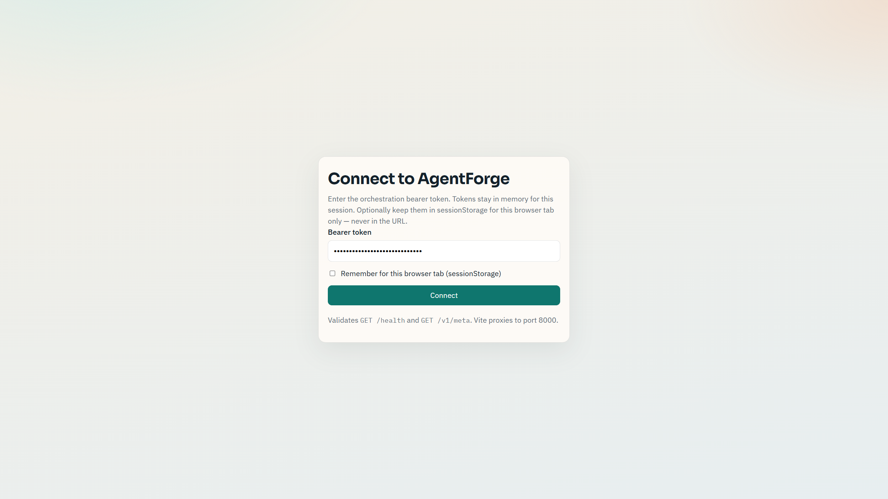
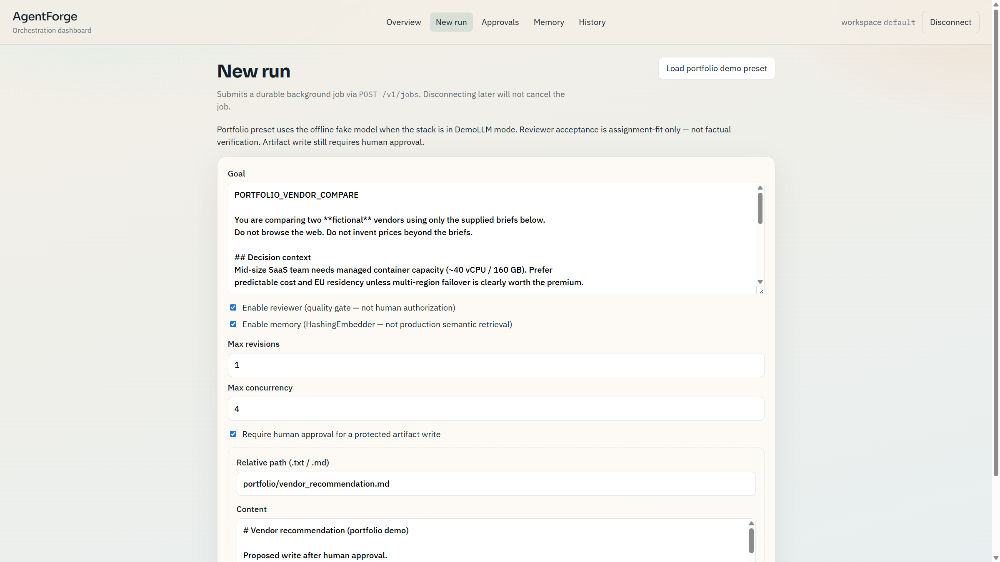
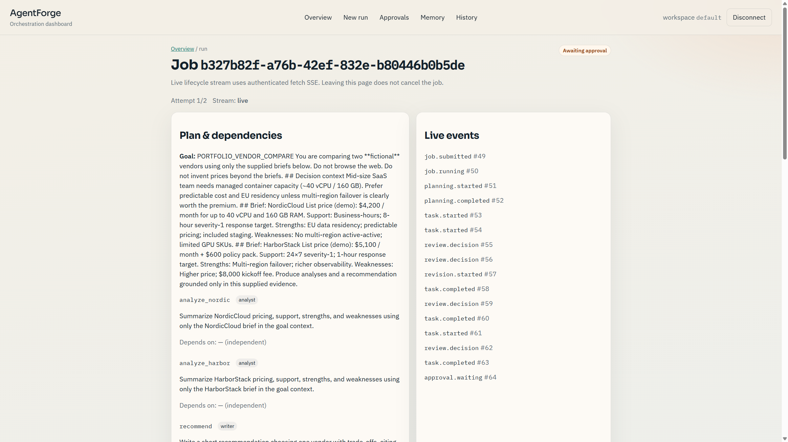
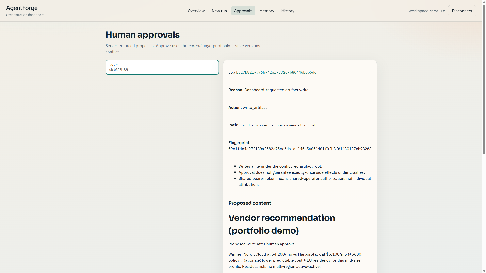

# AgentForge — AI Orchestration Platform

Custom multi-agent orchestration for a portfolio-grade demo: plan → concurrent
specialists → optional review/revise → durable jobs → memory → human approval →
live lifecycle streaming → React dashboard → single-host Docker Compose.

**Not an agent framework wrapper** (no LangGraph/ADK). **Not production-ready**
for multi-tenant or multi-host SQLite deployments. Offline demos use a labeled
**DemoLLM** (scripted replies ≠ live model intelligence).

## Quick start (offline — no paid API calls)

```powershell
cd ai-orchestration-platform
cp .env.example .env
# Set ORCHESTRATION_API_TOKEN in .env
docker compose -f docker-compose.yml -f docker-compose.offline.yml up --build -d
```

Open **http://127.0.0.1:8080** → Connect with your token → **New run** →
**Load portfolio demo preset** → submit → Approvals when prompted.

CLI twin: `python -m examples.portfolio_demo_offline`  
Ops: [`DEPLOY.md`](DEPLOY.md) · Demo script: [`docs/DEMO_SCRIPT.md`](docs/DEMO_SCRIPT.md) ·
Readiness: [`docs/READINESS.md`](docs/READINESS.md) · Architecture: [`docs/ARCHITECTURE.md`](docs/ARCHITECTURE.md)

### Screenshots (real offline stack)









More under [`docs/screenshots/`](docs/screenshots/README.md).

---

This project is a small custom runtime for talking to an LLM, running an agent, executing tools in a bounded loop, and planning multi-step work. It does not use an agent framework.

**LLMClient:** communicates with the model.

**Agent:** defines how a particular AI worker behaves.

**Runner:** executes an agent request, including tool calls.

**Tool:** one operation the model can ask the runner to perform.

**Supervisor:** turns a complex user goal into a validated execution plan. It does not run the plan.

**PlanExecutor:** assigns plan tasks to registered specialist agents, respects dependencies, and runs ready tasks concurrently in-process.

**OutputReviewer:** optional quality gate that checks a specialist output against its task and expected output, with bounded revisions. Acceptance is assignment-fit under supplied context, not proof of factual correctness.

**Orchestration service:** a FastAPI process that exposes the same engine over HTTP. Specialists and review stay inside the service. This is not a per-agent microservice mesh. Synchronous ``POST /v1/runs`` remains available. Background jobs (M8) use a durable SQLite job store plus Huey ``SqliteHuey`` for delivery; a separate worker process claims and executes jobs. Memory (M9) uses a separate SQLite store with in-process cosine similarity over stored vectors (no extra vector database).

An LLM client sends chat messages to a model provider and returns text, the model name, and token usage when the provider sends it. Callers use `generate(messages)` and receive an `LLMResponse`. The OpenAI SDK stays inside `app/llm/client.py`.

An agent is the worker built on top of that client. It owns a name, a system instruction, and an `LLMClient`. For one task it builds a system message and a user message, asks the client for one reply, and returns an `AgentResult`. The agent imports `LLMClient` from `app/llm/base.py`. It does not import the OpenAI SDK, so the same agent can run against another provider later by swapping the client.

`AgentRunner` is the execution entry point: `runner.run(agent, request)`. The agent decides the messages and which tools it may use. The runner calls the model, and when the model requests a tool, the runner executes that tool and calls the model again. The loop stops when the model returns a final answer or when `max_iterations` is reached. The default limit is 4 model calls.

A tool is a named operation with a description, a Pydantic input schema, and an `execute` method. The schema tells the model what arguments are valid. The calculator adds, subtracts, multiplies, and divides through explicit code. It does not evaluate arbitrary text.

The tool types do not mention OpenAI. `app/llm/client.py` is the only module that turns a tool schema into OpenAI's request format and parses OpenAI tool calls back into `ToolCall`. The client still does not run the tool. The runner does, because a tool call is a request, not a result. The model cannot call a Python function itself.

`ToolRegistry` stores the implementations available to one runner. It is not global. An agent has an allow-list, `allowed_tools`, and the runner shows the model only those tools. A registry can contain a calculator and a search tool while one agent is allowed to use only the calculator.

The supervisor asks the model for a JSON plan, validates the task graph, and repairs invalid output a bounded number of times. Planning aims for one LLM call when the first reply is valid. Repair calls run only after validation fails. Planning never executes tasks and never advertises tools.

`PlanExecutor` looks up each task’s role in an `AgentRegistry`, builds a prompt with the goal, assignment, expected output, and dependency results (labeled as untrusted data), and runs ready tasks through a fresh `AgentRunner` per task. Specialists default to no tools unless the caller registers agents with an explicit allow-list and supplies a tool registry.

Review is **off by default** for backward compatibility and latency. When enabled, each reviewed task keeps the concurrency slot for produce → review → revise. Downstream tasks only consume `succeeded` outputs. `quality_approved=true` means a reviewer accepted the output. An unreviewed `succeeded` task sets `quality_approved=false` and records a bypass reason — it is not quality-approved.

## What is implemented

- Typed settings loaded from environment variables
- Chat messages with roles `system`, `user`, `assistant`, and `tool`
- An abstract LLM client and one OpenAI implementation
- Timeouts and translation of provider failures into application exceptions
- An `Agent` with a name, a system instruction, and an optional tool allow-list
- An `AgentRunner` that loops between the model and the allowed tools
- A `ToolRegistry` and one calculator tool
- A maximum iteration count and a per-tool timeout
- A `Supervisor` that creates and validates an `ExecutionPlan`
- Plan metrics: `llm_calls`, `duration_ms`, model name, and token usage when the provider reports it
- An `AgentRegistry` and `PlanExecutor` for dependency-aware concurrent execution
- Optional `OutputReviewer` with bounded specialist revisions and separate reviewer JSON-repair bounds
- Visible review policy (`reviewed` vs bypass reasons) and frozen attempt/review history
- Per-task and overall execution timing; provider timeouts surface as `timed_out`
- FastAPI orchestration service (`GET /health`, `GET /v1/meta`, `POST /v1/runs`) with bearer auth, process-wide capacity limits, and sync execution off the event loop
- Background jobs (M8): `POST /v1/jobs` (HTTP 202), `GET /v1/jobs/{id}`, `GET /v1/jobs/{id}/result` with SQLite durable state and Huey SqliteHuey delivery
- Worker process with atomic claim/lease recovery; queue messages carry only `job_id`
- Memory (M9): short-term retrieved reference block per run + durable SQLite long-term summaries with trust labels; `GET/DELETE /v1/memory`
- Human-in-the-loop (M10): pause jobs for approval of a narrowly scoped artifact write; `GET/POST /v1/approvals...`; separate from M6 review
- Live streaming (M11): authenticated SSE lifecycle events for jobs via durable SQLite event log (API ↔ worker)
- Observability (M12): structured ops logs + OpenTelemetry spans with W3C propagation across API/worker; usage aggregation and dated fixture cost estimates; timeline replay from M11 events (not re-execution)
- Evaluation (M13): versioned offline dataset with held-out split, deterministic scoring + failure suite, review/memory config comparison, JSON/Markdown reports; live eval opt-in only (no automatic paid calls)
- Dashboard (M14): React + TypeScript UI with connect session, overview, new run, live SSE run detail, approvals, memory, history — same-origin Vite proxy; demo API with fake LLMs
- Deployment (M15): Docker Compose single-host packaging (API + worker + nginx UI), shared SQLite volume, `/ready` probes, offline DemoLLM overlay, backup/restore helpers — see `DEPLOY.md`
- Portfolio integration (M16): vendor-comparison offline demo (concurrent tasks, review revision, HITL artifact write, memory reuse), failure/recovery demo, docs + readiness report — see `docs/`
- Thin HTTP client with explicit timeouts and **no** automatic execute retries (plus job submit/poll helpers)
- Unit tests that mock the provider SDK and the LLM client
- Examples for client/agent/tools/planning/execution, offline review, jobs, observability/replay, and offline evaluation

## Project structure

```text
ai-orchestration-platform/
├── app/
│   ├── core/
│   │   ├── config.py        # environment settings
│   │   ├── messages.py      # ChatMessage and MessageRole
│   │   └── exceptions.py    # LLMConfigurationError, LLMProviderError, LLMTimeoutError
│   ├── llm/
│   │   ├── base.py          # LLMClient, LLMResponse, TokenUsage
│   │   └── client.py        # OpenAI implementation
│   ├── agent/
│   │   ├── agent.py         # identity, instruction, allowed tool names
│   │   ├── runner.py        # bounded tool-calling loop
│   │   ├── models.py        # AgentRequest and AgentResult
│   │   └── exceptions.py    # invalid agent, task, or iteration limit
│   ├── tools/
│   │   ├── base.py          # Tool and ToolResult
│   │   ├── registry.py      # register, get, and list tools
│   │   └── calculator.py    # add, subtract, multiply, divide
│   └── orchestration/
│       ├── models.py        # ExecutionPlan, PlanTask, PlanResult
│       ├── validation.py    # deterministic DAG checks
│       ├── supervisor.py    # create_plan
│       ├── prompts.py       # planning and repair instructions
│       ├── registry.py      # role → agent map
│       ├── context.py       # specialist prompt assembly
│       ├── executor.py      # dependency-aware scheduler + review pipeline
│       ├── execution.py     # TaskResult / ExecutionResult
│       ├── review.py        # ReviewResult, AttemptRecord, policy
│       ├── reviewer.py      # OutputReviewer
│       ├── review_prompts.py
│       └── exceptions.py    # planning, execution, and review errors
│   └── api/
│       ├── main.py          # FastAPI factory (uvicorn --factory)
│       ├── service.py       # engine adapter
│       ├── concurrency.py   # process-wide capacity gate
│       ├── config.py        # ORCHESTRATION_* settings
│       ├── client.py        # sync HTTP client (no execute retries)
│       ├── jobs/            # M8 store, queue, runtime, worker
│       └── v1/schemas.py    # versioned contracts
│   ├── memory/              # M9 store, embeddings, retrieval
│   ├── approval/            # M10 gate, proposals, artifact write
│   ├── observability/       # M12 tracing, metrics, usage, pricing, replay
│   └── evaluation/          # M13 dataset, harness, failure suite, reports
├── examples/
│   ├── chat_once.py
│   ├── run_agent.py
│   ├── run_agent_with_tools.py
│   ├── plan_request.py
│   ├── run_plan.py
│   ├── review_demo_offline.py
│   ├── compare_inprocess_vs_api.py  # fake workers; labeled timings
│   ├── run_via_api.py               # live HTTP client demo
│   ├── jobs_offline_demo.py         # submit → poll → result (fake LLM)
│   ├── memory_offline_demo.py       # store then retrieve (fake embeddings)
│   ├── approval_offline_demo.py     # pause → approve → artifact write
│   ├── stream_job_events_demo.py    # SSE lifecycle stream (fake LLM)
│   └── latency_baseline_m11.py      # cold vs warm HTTP P50/P95 (fake)
├── tests/
│   ├── test_llm_client.py
│   ├── test_agent.py
│   ├── test_tools.py
│   ├── test_agent_loop.py
│   ├── test_plan_models.py
│   ├── test_plan_validation.py
│   ├── test_supervisor.py
│   ├── test_agent_registry.py
│   ├── test_plan_executor.py
│   ├── test_reviewer.py
│   ├── test_review_integration.py
│   ├── test_api_schemas.py
│   ├── test_api_concurrency_unit.py
│   ├── test_api_service.py
│   ├── test_jobs_m8.py
│   ├── test_memory_m9.py
│   ├── test_approval_m10.py
│   └── test_streaming_m11.py
├── .env.example
├── requirements.txt
└── pyproject.toml
```

## Environment setup

From this directory, with Python 3.11 or newer:

```powershell
python -m venv .venv
.\.venv\Scripts\Activate.ps1
pip install -r requirements.txt
Copy-Item .env.example .env
```

On macOS or Linux, activate the virtual environment with `source .venv/bin/activate` and copy the example env file with `cp .env.example .env`.

## Configure the API key

1. Create an API key in your OpenAI account.
2. Open `.env` and set `LLM_API_KEY` to that key.
3. Set `LLM_MODEL` to a current chat model you can call, such as `gpt-4o-mini`.
4. Leave `LLM_PROVIDER` as `openai`.

`.env` is gitignored. `.env.example` contains only placeholder values. Do not put a real key in source files.

| Variable | Meaning |
| --- | --- |
| `LLM_PROVIDER` | Provider name. Task 1 implements `openai` only. |
| `LLM_MODEL` | Model name sent to that provider. |
| `LLM_API_KEY` | Secret used to authenticate. Read from the environment, never hardcoded. |
| `LLM_TIMEOUT_SECONDS` | How long one request may wait. Must be greater than 0. Default: 30. |
| `LLM_MAX_OUTPUT_TOKENS` | Upper bound on tokens the model may generate. Default: 512. |

If a variable is already set in the process environment, that value overrides `.env`.

## Run the examples

The examples make one real API call (or a few if planning needs repair) and can spend credits. Each one then exits.

Direct client call:

```powershell
python -m examples.chat_once
```

One agent task:

```powershell
python -m examples.run_agent
```

One calculator task. The model is allowed to call the calculator, and the runner executes it:

```powershell
python -m examples.run_agent_with_tools
```

One planning request. The supervisor returns a validated plan and does not execute tasks:

```powershell
python -m examples.plan_request
```

Plan and execute with registered specialists (no tools by default):

```powershell
python -m examples.run_plan
```

`run_agent` loads settings, creates the LLM client, builds a `general_assistant` agent, and runs the task "Explain microservices in simple terms." It prints the final answer, agent name, model, and token usage when OpenAI includes it.

`run_agent_with_tools` asks the model to calculate 125 multiplied by 48. The agent is allowed to use the calculator. The process log shows each model call, tool request, and tool result. The printed answer is the model's final explanation.

`plan_request` asks the supervisor to plan research-plus-summary work. It prints tasks, dependency order, `llm_calls`, `duration_ms`, model, and token usage when the provider reports it.

`run_plan` creates a plan, registers specialists with empty tool allow-lists, executes with review **off**, and prints per-task status, outputs, and timings. Unreviewed successes are not quality-approved.

Deterministic offline review demo (no API key):

```powershell
python -m examples.review_demo_offline
```

This shows acceptance, revision→acceptance, rejection + skipped downstream, downstream waiting for acceptance, and labeled fake-worker timing for review-off vs review-on.

### Orchestration HTTP service (M7 + M8)

Start the API (factory app; requires `ORCHESTRATION_API_TOKEN` unless local unauthenticated mode is explicitly enabled):

```powershell
uvicorn app.api.main:create_app --factory --port 8000
```

Start a background worker in a **second** PowerShell window (same venv, same `ORCHESTRATION_*` DB paths):

```powershell
python -m app.api.jobs.worker
```

Offline jobs demo (fake LLM, in-process immediate Huey — no separate worker, no paid calls):

```powershell
python -m examples.jobs_offline_demo
```

Offline in-process vs local HTTP comparison (fake workers, labeled timings):

```powershell
python -m examples.compare_inprocess_vs_api
```

Live client against a running server:

```powershell
python -m examples.run_via_api
```

`POST /v1/runs` waits until the run finishes. Sync engine work runs in a worker thread (`asyncio.to_thread`) so the event loop is not blocked. Process-wide capacity is reserved for the whole run and released only when that work returns. There is **no** service timeout that claims to cancel running threads. Client disconnect or read timeout can leave an **uncertain** outcome; the HTTP client does **not** auto-retry execute requests. Capacity limits apply to **one process**, not replicas. Tools stay disabled.

#### Background jobs (M8)

Stack (verified against Huey docs for Python 3.13 / Windows local path): **Huey `SqliteHuey`** for queue delivery + a **separate SQLite `JobStore`** for authoritative status and results. An in-memory dict is never treated as durable. Queue messages contain only `job_id` (no credentials, no results).

| Endpoint | Behavior |
| --- | --- |
| `POST /v1/jobs` | Validate → durable INSERT (`queued`) → enqueue → **HTTP 202** + `job_id` |
| `GET /v1/jobs/{id}` | Status, attempt, timing (submit / queue wait / execute / total) |
| `GET /v1/jobs/{id}/result` | Terminal result (or 409 if not ready) |

States: `queued` → `running` → `succeeded` | `failed`. Lease expiry / worker crash → `interrupted` (re-queued under `ORCHESTRATION_MAX_JOB_ATTEMPTS`). Infrastructure retries are separate from specialist revisions and reviewer repairs. Duplicate delivery is ignored while a valid lease is held (atomic claim). If durable create succeeds and enqueue fails, the job stays `queued` and recovery re-enqueues it. Exactly-once LLM/tool side effects are **not** promised; uncertain outcomes are recorded on the job.

Auth uses the same bearer boundary as M7. A shared bearer token is **not** multi-user isolation. HTTP disconnect after 202 cannot release worker capacity — capacity is held only while a worker executes a claimed job (process-local gate).

#### Memory (M9)

**Why SQLite, not a vector DB:** M8 already standardized on local SQLite. Memory reuses that pattern: rows + embedding JSON in `ORCHESTRATION_MEMORY_DB_PATH`, cosine similarity in-process. That avoids Redis/Docker/Chroma for the portfolio local path. Default embedder is a deterministic hashing model (offline); it does **not** claim real semantic quality.

| Concept | Behavior |
| --- | --- |
| Short-term | Retrieved reference block for one run (not a second durable store) |
| Long-term | SQLite summaries with trust `reviewed` / `unreviewed` / `failed_approach` |
| Scope | `ORCHESTRATION_WORKSPACE_ID` from trusted config — **single-workspace** with shared token |
| Control | `memory_enabled` on run/job requests; `GET/DELETE /v1/memory` |
| Retention | Soft-delete + clear vectors; purge soft-deleted past retention; running jobs keep their snapshot |
| Metrics | `timing.memory`: retrieval_ms, embed_ms, cache hits, returned_count, context_chars |

Retrieved memory is labeled untrusted and must not override the current task, tools, or approvals. Does not auto-store full conversations, credentials, or raw tool dumps.

Offline demo (fake LLM + hashing embeddings):

```powershell
python -m examples.memory_offline_demo
```

#### Human-in-the-loop approval (M10)

Protected side effects are gated in **trusted application code** after LLM work. The model cannot approve itself via memory, dependency text, or tool args. M6 ``quality_approved`` is reviewer acceptance — **not** human authorization.

| Piece | Behavior |
| --- | --- |
| Job status | `awaiting_approval` persists proposal + checkpoint; **no worker lease/capacity** |
| Proposal | Exact action, args, reason, risks, fingerprint; material change → revise + fresh approval |
| APIs | `GET /v1/approvals`, `GET /v1/approvals/{id}`, approve / reject / revise |
| Demo action | `write_artifact` under `ORCHESTRATION_ARTIFACT_OUTPUT_ROOT` (`.txt`/`.md` only) |
| Sync runs | `POST /v1/runs` rejects `protected_action` — use `POST /v1/jobs` |
| Auth | Shared bearer token ⇒ **shared-operator** decisions (not individual attribution) |

Resume continues from the checkpoint without re-running completed specialist tasks. Approval does **not** imply exactly-once external effects; identical artifact rewrites are idempotent, crashes mid-write may leave uncertainty.

```powershell
python -m examples.approval_offline_demo
```

#### Live streaming & latency (M11)

`GET /v1/jobs/{id}/events` streams **lifecycle** SSE (planning, tasks, review, revision, approval wait/resume, terminal). Events are persisted in SQLite (default: same file as jobs) so the API process can stream what the worker commits. This is **not** model-token streaming — fabricating token chunks from a finished reply is out of scope and not labeled as live generation.

| Concern | Behavior |
| --- | --- |
| Auth | Same Bearer boundary. Prefer `Authorization` header / fetch streaming; native `EventSource` cannot set Bearer — do not put secrets in URLs |
| Replay | Stable numeric `id` + `Last-Event-ID`; expired history → `stream.replay_gap` then continue from earliest retained |
| Disconnect | Does not cancel the job or release worker capacity |
| Retention | Per-job cap (`ORCHESTRATION_EVENTS_MAX_PER_JOB`) |
| Scope | Shared token ⇒ single-workspace, not multi-user isolation |

```powershell
python -m examples.stream_job_events_demo
python -m examples.latency_baseline_m11
```

Latency script reports sample count, P50/P95 for client wait, server total, and approximate HTTP overhead under a **fake** 50 ms LLM — connection reuse vs new client. Treat any prior “~300 ms overhead” claim as something to verify on your machine.

#### Observability, cost, and replay (M12)

Runs expose explainable telemetry without a mandatory monitoring SaaS stack.

| Piece | Behavior |
| --- | --- |
| Correlation | `run_id` / `task_id` / attempt in logs + OTel spans; W3C `traceparent` stored on the job and re-attached in the worker |
| Safety | Default redaction of credentials, Authorization, prompts, and generated content; opt-in `ORCHESTRATION_TELEMETRY_CAPTURE_CONTENT` |
| Metrics | Queue wait, execution duration, failures, timeouts, retries, review outcomes, revisions, capacity deferrals — **no** run/task IDs as metric labels |
| Usage | Aggregated from planning + specialist attempts + reviewer calls; task-level usage copies are not double-counted; missing usage is **unknown**, not zero |
| Cost | Dated fixture pricing (`app/observability/pricing_fixtures.json`); estimates labeled with coverage (`complete` / `partial` / `unavailable`) |
| Replay | `GET /v1/jobs/{id}/replay` plays back durable events only; a true rerun is a new job and must re-satisfy approvals |
| APIs | `GET /v1/jobs/{id}/observability`, `GET /v1/jobs/{id}/replay` |

See `app/observability/RETENTION.md` for retention policy hints.

```powershell
python -m examples.observability_offline_demo
```

Configuration problems raise `LLMConfigurationError`. A blank agent name or system instruction raises `AgentConfigurationError`. A blank task raises `AgentRequestError`. A blank planning goal raises `PlanRequestError`. A provider failure raises `LLMProviderError`. A request that exceeds `LLM_TIMEOUT_SECONDS` raises `LLMTimeoutError`. The agent and supervisor do not replace those provider errors with a new exception. A run that never reaches a final answer raises `AgentMaxIterationsError`. Exhausting plan repairs raises `PlanGenerationError`.

## Run the tests

```powershell
pytest
```

Client tests mock `openai.OpenAI`. Agent, tool-loop, and supervisor tests use a fake `LLMClient`. None of the tests contact the API.

## Planning quality, latency, and evaluation

### Automated checks

- Unique task ids, known dependencies, no self-dependencies, no cycles
- Non-empty plans within `max_tasks` (default 12)
- Closed specialist roles
- Bounded repair (`max_repair_attempts`, default 2 → at most 3 model calls)
- Mocked success path uses exactly one LLM call; repair path records call count

### Not automated yet (needs human or later model-based review)

- Whether the plan truly matches the user's intent
- Whether task descriptions and expected outputs are clear enough to execute well
- Whether the plan is unnecessarily large or over-dependent
- Real-world latency and cost against a live model

### Measuring live planning latency later

Do not treat a single example run as a benchmark. For a chosen goal and model:

1. Run `Supervisor.create_plan(goal)` many times (for example 30+).
2. Record each `PlanResult.duration_ms` and `llm_calls`.
3. Sort durations and report P50 and P95.
4. Separate successful first-attempt runs (`llm_calls == 1`) from repaired runs.

This repository does not claim a latency improvement without those measurements.

### Execution timeouts and concurrency (honest limits)

What exists today:

- Provider LLM request timeout via `LLM_TIMEOUT_SECONDS` on `OpenAIChatClient`
- Per-tool wait timeout inside `AgentRunner` (waiting on a future does not forcibly stop a running tool thread)
- Agent loop bound via `max_iterations`
- Concurrent specialists via `ThreadPoolExecutor` over **synchronous** `generate` / `AgentRunner.run` calls

What does **not** exist:

- Cooperative cancellation tokens on `Agent` / `LLMClient`
- A guarantee that timed-out work has stopped making LLM or tool calls
- An asyncio event-loop execution path

`PlanExecutor` therefore does not free a concurrency slot until the worker callable returns, and `execute()` does not return while submitted workers are still running. `LLMTimeoutError` from a specialist is recorded as task status `timed_out`; dependents are skipped. That status means the wait/provider path reported a timeout, not that the process forcibly killed a thread.

Thread-safety assumptions:

- Do not mutate `AgentRegistry` or a shared `ToolRegistry` during `execute`
- Each task uses a fresh `AgentRunner`
- Specialist agents are treated as read-only during the run
- Sharing one `LLMClient` across threads assumes the provider SDK allows concurrent requests (common for the OpenAI client; not proven here for every provider)

Mocked tests may show wall-clock overlap with sleeping fake workers. That measures scheduler overlap only. It is not evidence of live API latency.

### Review and revision (M6)

Default: `review_enabled=False` (M5-compatible).

When enabled:

- Reviewer checks task coverage, expected-output fit, internal consistency, and consistency with **supplied** evidence only
- `independently_verified_facts` is always false; acceptance is not factual proof
- Specialist revisions and reviewer JSON repairs use **separate** bounds (`max_revisions`, `max_review_repair_attempts`)
- Metrics distinguish `review_decision_count`, `reviewer_model_calls`, `reviewer_repair_calls`, and `revision_count`
- Missing token usage stays unavailable (`None`), never coerced to zero
- Attempt/review history is frozen (immutable snapshots)
- Statuses: `rejected` (revision budget exhausted), `failed` (reviewer error / `cannot_assess`), `timed_out` (provider timeout)

Maximum extra work for one reviewed task (configuration upper bound):

- Specialist attempts ≤ `1 + max_revisions`
- Each specialist attempt ≤ `max_iterations` model calls inside `AgentRunner` (plus tool waits if tools are enabled)
- Reviewer decisions ≤ specialist attempts
- Reviewer model calls ≤ specialist attempts × (`1 + max_review_repair_attempts`)

Shared `OutputReviewer` keeps request state in locals per `review()` call (no mutable per-request fields on the instance). Concurrent use still depends on LLM client thread safety (same M5 assumption). Delimiters reduce accidental instruction mix-ups; they are **not** a complete prompt-injection defense. Mocked injection tests prove prompt construction and tool-free review wiring — not that a live model will ignore adversarial text.

### Evaluation harness (M13)

Versioned dataset `app/evaluation/data/dataset_v1.json` declares expected behavior **before** runs. A small **held-out** split is separate from prompt-tuning cases. Offline runs use fake providers; memory is reset per case and labeled as **HashingEmbedder** (not production semantic retrieval).

| Piece | Behavior |
| --- | --- |
| Quality | Deterministic checks (status, evidence substrings, uncertainty markers) + human-readable rubric proxies — not exact full-string grading |
| Configs | Same tasks under review off/on × memory off/on |
| Failures | Timeouts, malformed plans, storage, duplicate delivery, crash recovery, stream disconnect, approval races, approval bypass attempts |
| Judge | Optional proxy separate from `OutputReviewer`; calibrated on a tiny human set; never sole source of truth |
| Live | Opt-in only (`--confirm-paid-calls`); this checkout refuses automatic paid calls |
| Reports | `eval_report.json` + `eval_report.md` with P50/P95, usage/cost coverage, unsuccessful runs listed |

```powershell
python -m app.evaluation offline --out reports/eval_offline
python -m examples.run_evaluation_offline
python -m app.evaluation regen reports/eval_offline/eval_report.json
```

Mocked results are workflow/regression evidence — **not** live model quality claims. Small N ⇒ unstable percentiles; do not overstate significance.

#### Dashboard (M14)

React + TypeScript UI in `frontend/` talks to the real API (same-origin Vite proxy). Demo mode uses fake LLMs via `examples.demo_api_server`.

```powershell
.\.venv\Scripts\python.exe -m examples.demo_api_server
cd frontend; $env:VITE_DEMO_MODE="true"; npm run dev
```

Connect with bearer token `demo-token`. See `frontend/README.md`.

## Execution flow

```text
User
 ↓
AgentRunner
 ↓
LLM
 ↓
Tool Call?
 ├── No → Final Answer
 └── Yes
       ↓
   Tool Registry
       ↓
   Tool Execution
       ↓
   Tool Result
       ↓
      LLM
       ↓
    Repeat
```

Planning flow:

```text
User goal
 ↓
Supervisor
 ↓
LLM (no tools)
 ↓
Parse JSON → validate DAG
 ├── valid → ExecutionPlan + metrics
 └── invalid → repair (bounded) or PlanGenerationError
```

Execution flow:

```text
ExecutionPlan
 ↓
AgentRegistry (fail fast if a role is missing)
 ↓
PlanExecutor
 ↓
ready tasks (deps succeeded / accepted for downstream)
 → ThreadPoolExecutor (max_concurrency)
 ↓
produce (fresh AgentRunner) → optional review → bounded revise
 ↓
succeeded (eligible downstream; quality_approved only if reviewed+accepted)
rejected / failed / timed_out → skip dependents
 ↓
ExecutionResult + frozen attempt history + review metrics
```

1. `load_settings()` reads the environment and validates it with Pydantic.
2. `create_llm_client(settings)` returns an `OpenAIChatClient`, typed as `LLMClient`.
3. The agent stores that client, a system instruction, and the tool names it may use.
4. `AgentRunner` resolves those names in its `ToolRegistry` and builds the system and user messages.
5. Each loop iteration calls `generate(messages, allowed_tools)` once.
6. A text reply with no tool call becomes an `AgentResult`.
7. Tool calls are appended as an assistant message. The runner validates each call, runs the matching allowed tool, and appends a tool result. Several calls in one reply run one after another.
8. If the model is still requesting tools after `max_iterations` model calls, the runner raises `AgentMaxIterationsError`. The limit is what stops a tool call from leading to another tool call forever.
9. A provider timeout stays an `LLMTimeoutError`. Other SDK failures stay an `LLMProviderError`. A tool that returns an error is sent back to the model as a tool result. An unexpected tool exception becomes a short failure message and does not include the raw traceback.
10. `Supervisor.create_plan(goal)` calls the LLM without tools, validates the plan graph, and returns `PlanResult`.
11. `PlanExecutor.execute(plan)` runs registered specialists with dependency-aware concurrency and returns `ExecutionResult`.

The dependency direction is agent runner to agent to the LLM abstraction, agent runner to the tool abstraction, supervisor to the LLM abstraction, and plan executor to the agent registry and runners. The OpenAI SDK stays in `app/llm/client.py`.

## Not implemented yet

- Provider-backed embeddings / dedicated vector DB (optional later)
- Per-user approver identity (beyond shared-operator token)
- Model-token streaming (distinct from lifecycle SSE)
- Per-specialist remote services
- Live paid evaluation driver under explicit budgets (scaffolding refuses auto-calls)
- Parallel tool calls inside a single agent turn
- True cancellation of in-flight LLM or tool work
- Cross-replica capacity coordination / Redis-backed multi-host queues

`Agent.run(task)` still performs one text generation and does not execute tools. Tool use goes through `AgentRunner`. `examples/run_plan.py` keeps review off; use `examples/review_demo_offline.py` for the review workflow demo. Use `examples/compare_inprocess_vs_api.py` for labeled fake-worker HTTP overhead — not a claim that microservices improve quality or latency.
